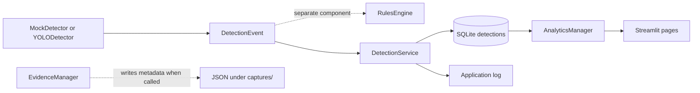

# SEDS V2

**Smart Elephant Detection System (SEDS) V2** is an early-stage, local wildlife detection project. It currently contains image-based YOLO inference, a configurable class/confidence rules component, SQLite persistence, JSON evidence metadata writing, and a Streamlit dashboard. These components are not yet connected into a complete automated monitoring system.

> **Status:** Prototype for development and simulation on macOS. Raspberry Pi deployment has not been validated. `app/main.py` initializes configuration, logging, and the database; it is not a detection-system launcher.

## Motivation and problem

Wildlife entering human-populated areas can create risks for people, animals, crops, and property. SEDS explores a local, edge-oriented workflow for identifying target wildlife and recording detections. This repository is a starting implementation, not a field-proven system. It does not establish detection accuracy, response time, or conservation impact.

## Objectives

- Explore image-based wildlife detection with Ultralytics YOLO.
- Represent detections as Python events and persist records locally.
- Provide basic history and confidence analytics through Streamlit.
- Build toward a maintainable, reproducible edge monitoring platform while keeping planned work separate from implemented behavior.

## Current feature status

| Capability | Status | Evidence / limitation |
|---|---|---|
| YOLO inference on an image | Implemented in code; runtime depends on weights and installed dependencies | `detection/yolo_detector.py` loads `models/yolov8n.pt` and returns one event per box. |
| Mock detection | Implemented in code | `detection/mock_detector.py` returns a fixed elephant event. |
| Confidence and class rules | Implemented as a separate component | `decision/rules_engine.py` reads YAML values; `DetectionService` does not call it. |
| SQLite detection records | Partially implemented | `DatabaseManager` creates a table without `event_id` but inserts include it; fresh databases can fail. |
| Dashboard | Implemented, basic | Home metrics, a history table, and confidence histogram read SQLite through `AnalyticsManager`. |
| Evidence metadata | Partially implemented | `EvidenceManager` can write JSON metadata. It is not called by `DetectionService`; automatic image storage is absent. |
| Event IDs | Partially implemented | `EventManager` generates IDs; no time/space event aggregation is implemented. |
| Camera, video, tracking, cloud, alerts, active learning | Planned or placeholder only | No complete corresponding pipeline is present. |
| Raspberry Pi operation | Hardware-unverified | No deployment or performance validation is documented. |

## Architecture overview



The diagram shows available components, not an automatically orchestrated end-to-end flow. See [Architecture](docs/Architecture.md) and [Detection Pipeline](docs/DetectionPipeline.md).

## Project documentation

- [Folder structure](docs/FolderStructure.md)
- [Database](docs/Database.md)
- [Dashboard](docs/Dashboard.md)
- [Raspberry Pi deployment plan](docs/RaspberryPiDeployment.md) — unvalidated on hardware
- [Testing guide](docs/Testing.md) — describes current scripts; no pytest suite is claimed
- [Roadmap](docs/Roadmap.md) — proposed work is labeled as planned
- [Code quality audit](docs/CodeQualityAudit.md) — findings and recommended follow-up

## Technology

The pinned environment in `requirements.txt` includes Python packages for OpenCV, Ultralytics/PyTorch, NumPy, Pandas, Streamlit, Plotly, and PyYAML, among others. Python 3.11 is the intended development version. The repository does not currently declare direct versus transitive dependencies separately.

## Setup (macOS, Python 3.11)

From the repository root, create and activate an isolated environment, then install the checked-in pins:

```bash
python3.11 -m venv venv
source venv/bin/activate
python -m pip install --upgrade pip
python -m pip install -r requirements.txt
```

These are setup instructions based on the repository layout and requirements; a clean installation was not verified as part of this documentation stage. On Apple Silicon, PyTorch/OpenCV installation and inference behavior should be validated in the chosen Python environment.

### Model file

`YOLODetector` currently constructs `YOLO("models/yolov8n.pt")`. With the pinned Ultralytics package, loading this known asset name can attempt to download the weight file if it is missing. From the repository root, after installing dependencies, initialize the detector to request the model:

```bash
python -c "from detection.yolo_detector import YOLODetector; YOLODetector()"
```

This requires network access when the weights are absent; the command was not run during this stage. On macOS, calculate the local model checksum with:

```bash
shasum -a 256 models/yolov8n.pt
```

For reproducibility, contributors should record that checksum, the model source, and the Ultralytics version in experiment notes. No expected checksum is provided by this repository. The root `yolov8n.pt` is tracked in repository history but is deleted in this worktree; a local copy exists under `models/` and is ignored by Git. No repository-managed model downloader or checksum manifest currently exists. Review the model's own license and distribution terms.

## Running the application components

`app/main.py` is only an initialization placeholder. From the repository root, after setup:

```bash
python -m app.main
```

This initializes the logger, reads `config/config.yaml`, and constructs `DatabaseManager`; it does **not** run inference, apply rules, or start a camera/video stream. The database creation path is affected by the `event_id` schema mismatch described in [Database](docs/Database.md).

### Streamlit dashboard

Launch from the repository root so relative database and config paths resolve consistently:

```bash
streamlit run dashboard/Home.py
```

Streamlit discovers the additional pages in `dashboard/pages/`. The dashboard reads the local SQLite database. Home metrics can fail when there are no rows because average confidence is `None` and the page rounds it. The history page expects six values per row, including `event_id`, so the current source-created five-column schema is incompatible.

## Tests and development scripts

Files under `tests/unit/` and `tests/integration/` are currently executable scripts that print output and may write to the database, log, or captures directories. They are not pytest tests: they lack test functions/assertions and pytest is not listed in `requirements.txt`. Hardware and performance test folders contain no substantive cases. Inspect each script before running it and expect side effects. No test suite is claimed as passing.

## Data and database

The manager uses `database/seds.db` relative to the current working directory. The database is ignored by Git and initialized by `DatabaseManager`. Detection image paths are stored as strings; `EvidenceManager` writes JSON metadata under date-based `captures/YYYY/MM/DD/` folders when called. The detection service does not automatically save images or metadata. See [Database](docs/Database.md).

## Limitations and deployment status

- The application entry point does not orchestrate detection.
- The rules engine, detector, evidence manager, and persistence service are separate components.
- The database create/insert schema mismatch affects fresh databases.
- No automated pytest coverage or verified clean-install workflow is present.
- No video inference, object tracking, camera capture pipeline, cloud synchronization, or notification integration is implemented.
- Raspberry Pi 4B deployment, CPU performance, memory use, camera operation, and startup behavior are not validated.
- No accuracy, latency, or benchmark results are claimed.

## Roadmap

The intended direction is core architecture and reproducibility, dashboard/repository documentation, then video/tracking, improved evidence management, cloud synchronization, IoT alerts, Raspberry Pi validation, and active learning. This roadmap is aspirational; see the source before treating any capability as available.

## Contributing

Contributions should preserve the prototype's existing behavior, include reproducible evidence for claimed functionality, and clearly label untested or hardware-dependent behavior. Until dedicated contribution guidance is added, open a GitHub issue with the use case, environment, and reproduction steps before proposing substantial changes.

## License

The original SEDS V2 project files are distributed under the MIT License; see [LICENSE](LICENSE) for the terms and copyright notice. Third-party packages and model weights may have separate licenses and terms.

## Author

**Sadique Ul Hussain** — developer of SEDS V2.
