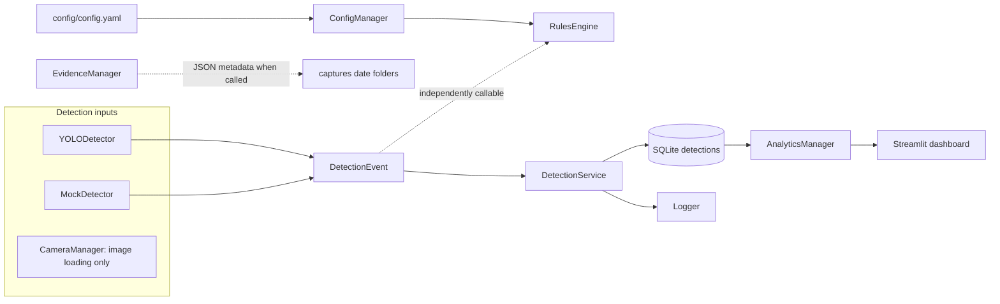
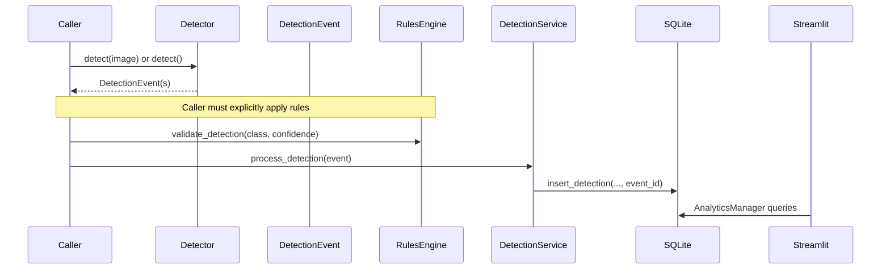

# SEDS V2 Architecture

## Scope and status

This page describes the code currently in the repository. It is a component map, not a claim that all components are wired into an operating service. YOLO inference is image-based; camera/video operation, tracking, cloud synchronization, and alerts are not implemented as end-to-end capabilities. Raspberry Pi operation is unvalidated.

## Current component view

The dashed edges matter: `DetectionService` does not call `RulesEngine` or `EvidenceManager`, and the repository does not provide a main orchestration component joining these pieces.

## Layers and responsibilities

| Area | Current responsibility |
|---|---|
| `app/` | Minimal startup routine, event dataclass, and file logger. |
| `config/` | Loads YAML and provides nested-key lookup. |
| `detection/` | Mock event creation, YOLO image inference, OpenCV image loading, and detection persistence/logging service. |
| `decision/` | Reads confidence/class settings, validates one detection, and generates event IDs. |
| `database/` | Creates/queries SQLite and computes simple aggregate values. |
| `storage/` | Writes JSON metadata files into date-partitioned capture directories. |
| `dashboard/` | Streamlit pages that query database analytics. |

`alerts/`, `cloud/`, and `tracking/` are currently package placeholders. `active_learning/`, `scripts/`, and `docs/` contain no implementation scripts at this baseline (the documentation directory is being populated as part of this stage).

## Current data flow

1. `MockDetector.detect()` creates a fixed elephant event, or `YOLODetector.detect(image_path)` runs a YOLO model and returns an event per detected box.
2. `DetectionEvent` carries timestamp, class, confidence, image path, and an optional event ID.
3. `RulesEngine.validate_detection(class, confidence)` can check configured target classes and threshold, but callers must invoke it explicitly.
4. `DetectionService.process_detection(event)` calls SQLite insertion and logs the class/confidence.
5. `AnalyticsManager` reads totals, average confidence, records, and confidence values. Streamlit renders those values.
6. `EvidenceManager.save_metadata()` can independently serialize supplied metadata to a JSON file. The detection service does not call it.

The database step can fail on a newly initialized database because the table definition and insertion disagree about `event_id`.

## Event lifecycle and persistence

`EventManager.create_event_id()` returns an `EVT-` prefixed truncated UUID. It does not group detections by time, location, or track. `DetectionService` stores one row per call; the same event ID can be reused by a caller, but no aggregation policy is applied. Image-path strings are stored in SQLite; image files are not automatically copied or saved by this service.

SQLite is stored at the relative path `database/seds.db`. The dashboard uses `AnalyticsManager`, which instantiates `DatabaseManager` and executes direct SQL. See [Database](Database.md).

## Current limitations

- Startup is initialization only; no pipeline coordinator exists.
- Configured threshold/class rules are not automatically enforced during persistence.
- Evidence metadata storage is disconnected from detection processing.
- No automatic evidence-image storage or time/space aggregation exists.
- Connections are manually closed; exceptions can interrupt that cleanup.
- The schema mismatch can prevent inserts against a fresh database.
- Components use working-directory-relative paths, so launching from another directory may resolve files differently.
- The dashboard assumes a six-column row in history while source-created schema has five columns.
- Tracking, video, cloud, alerting, and hardware operation are future work.

## Planned architecture improvements

Potential later work includes a small orchestrator, explicit dependency/config injection, a schema migration/version strategy, robust connection lifecycle handling, validated evidence references, and isolated automated tests. These are proposals, not current features. Schema and data-preservation work requires a migration plan.
