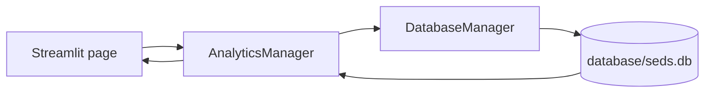

# Streamlit Dashboard

## Pages

The dashboard is implemented as a Streamlit multipage app rooted at `dashboard/Home.py`:

| Page | Source | Current behavior |
|---|---|---|
| Home | `dashboard/Home.py` | Shows total detections and average confidence metrics. |
| Detection History | `dashboard/pages/History.py` | Displays `AnalyticsManager.get_all_detections()` as a dataframe with six labels. |
| Analytics | `dashboard/pages/Analytics.py` | Displays a Plotly histogram of stored confidence values. |

There are no filters, evidence previews, camera controls, or live detection actions in these pages.

## Data flow

Each page constructs `AnalyticsManager`. That constructs `DatabaseManager`, which initializes the SQLite table if absent. Analytics queries then read from `database/seds.db` relative to the working directory. The dashboard does not call a detector or populate detections itself.



## Setup and launch

Use Python 3.11, create/activate the repository virtual environment, and install `requirements.txt` as described in the README. From the repository root:

```bash
streamlit run dashboard/Home.py
```

`dashboard/Home.py` calculates and appends the repository root to `sys.path`. The page scripts `dashboard/pages/History.py` and `dashboard/pages/Analytics.py` calculate and append the `dashboard/` directory instead. The database path remains relative to the current working directory, so launching from the repository root is the documented procedure. This command is documented from the actual file layout; dashboard startup was not executed during this documentation stage.

## Data and known issues

- The home page rounds the average confidence. On an empty database the aggregate is `None`, so `round(None, 2)` can raise a `TypeError`.
- The database manager creates a five-column table, while history assigns six DataFrame labels including `Event ID`. With five-value rows, DataFrame construction can fail due to the column-count mismatch.
- Detection insertion expects an `event_id` column missing from the source-defined table. See [Database](Database.md).
- `AnalyticsManager` opens connections directly and performs no dashboard-level error handling.
- The database is local and ignored by Git; a fresh clone starts without prior records.

## Troubleshooting

| Symptom | Likely cause / check |
|---|---|
| `streamlit: command not found` | Activate the intended Python 3.11 virtual environment and confirm requirements installation. |
| Config/database path errors | Run the command from the repository root. |
| Missing `event_id` SQLite error | Current schema mismatch; do not drop or recreate the database. Inspect the schema and plan a migration before changing data. |
| Home page fails with `None` rounding | No detections exist; empty-state handling is not implemented. |
| History page reports a columns mismatch | Source-created rows have five columns while page labels expect six. |
