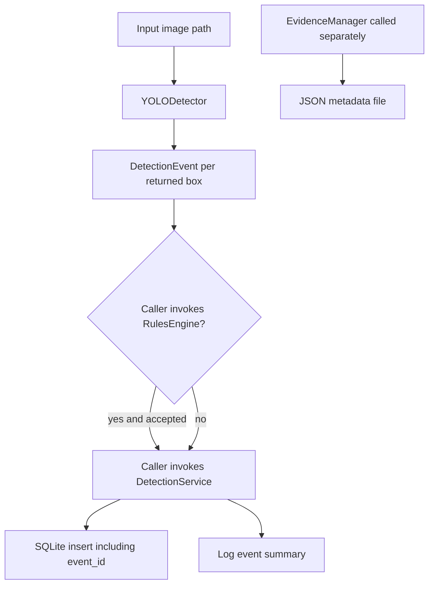

# Detection Pipeline

## Current scope

The repository has separate image inference, event, filtering, and persistence components. There is no complete production runner that automatically connects them. `app/main.py` initializes dependencies only. Video processing, tracking, automatic evidence-image saving, and time/space event aggregation are not implemented.

## Image loading and model inference

`CameraManager.load_image(image_path)` calls `cv2.imread` and returns its result. It does not open a physical camera or validate a failed/empty image.

`YOLODetector` loads `models/yolov8n.pt` during construction. Its `detect(image_path)` passes the path to the Ultralytics model, iterates returned boxes, resolves each class name using `model.names`, reads each confidence, and returns one `DetectionEvent` per box. It does not apply the configured confidence threshold or target-class list itself. Runtime depends on a compatible local weights file and installed dependencies; no benchmark is claimed.

`MockDetector.detect()` returns one fixed elephant event at confidence `0.92`, with a sample image path. It is useful as a stub, not as a real detector.

## DetectionEvent

`app.models.DetectionEvent` stores:

- `timestamp`: string
- `object_class`: string
- `confidence`: numeric value
- `image_path`: string
- `event_id`: string defaulting to empty

The dataclass does not validate values or generate an event ID automatically.

## Rules and target classes

`RulesEngine` reads `detection.confidence_threshold` and `detection.target_classes` from `config/config.yaml`. `validate_detection(object_class, confidence)` returns false if the class is not configured and otherwise checks `confidence >= threshold`. The current configuration sets threshold `0.85` and target `elephant`.

This filtering is opt-in: `DetectionService.process_detection()` does not call `RulesEngine`. A caller must explicitly filter detections before invoking persistence.

## Event IDs and aggregation

`EventManager.create_event_id()` generates a short `EVT-` identifier from a UUID. It creates an identifier only; it does not merge nearby detections or aggregate by time, location, or tracked object. Callers can attach an ID to multiple events, but the policy is external to this module.

## Persistence and logging

`DetectionService` constructs a `DatabaseManager` and logger. For each event it calls `insert_detection()` with timestamp, class, confidence, image path, and event ID, then logs a summary and returns `True` if execution reaches the end.

There is a schema defect: table creation defines `id`, `timestamp`, `object_class`, `confidence`, and `image_path`; insert SQL also requires `event_id`. A newly created database may reject the insert. The service does not save image files or call `EvidenceManager`.

## Evidence metadata

`EvidenceManager` can create `captures/YYYY/MM/DD/` and write caller-supplied JSON metadata to `<event_id>.json`. This is a standalone capability, not part of the detection service's current path. No automatic image/evidence image storage is implemented by the service.

## Actual and intended flow

The connection between filtering and persistence is caller-controlled. Diagrammed components do not imply the application currently runs this flow end-to-end.
